# Forever Chronicaller: system topology

A high-level map of how the system fits together: what runs where, how the pieces talk to each other, where data lives, and which file does what.
For *using* it, see [README.md](../README.md). For working rules, see [CLAUDE.md](../CLAUDE.md).

- [1. The big picture](#1-the-big-picture)
- [2. Addon architecture](#2-addon-architecture)
- [3. How things happen: event flow](#3-how-things-happen-event-flow)
- [4. Data model](#4-data-model)
- [5. Goals](#5-goals)
- [6. Player-to-player messaging](#6-player-to-player-messaging)
- [7. Companion app](#7-companion-app)
- [7a. Telemetry (opt-in)](#7a-telemetry-opt-in)
- [8. Build, test and release pipeline](#8-build-test-and-release-pipeline)
- [9. Component : function map](#9-component--function-map)
- [10. Design rules and constraints](#10-design-rules-and-constraints)
- [11. Where to start reading](#11-where-to-start-reading)

---

## 1. The big picture

Three things run in three places:

| Part | Runs | Language | Job |
|---|---|---|---|
| **Addon** | inside the WoW: Forever client | Lua 5.1 (WoW API ≈ retail 12.1.5, Midnight-style restrictions) | Chronicle, goals, map, UI, talks to friends' addons |
| **Companion app** | on the player's PC, outside the game | Python 3 (or a standalone `.exe` / Linux binary) | Installs/updates the addon, posts entries to Discord/phone |
| **CI/CD** | GitHub Actions | YAML + bash | Tests every push, builds and publishes releases |

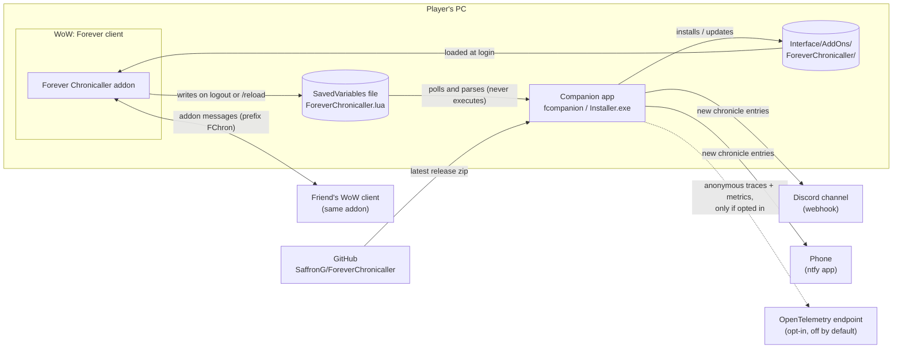

**Why it's shaped like this:** WoW addons are sandboxed. They have **no network and no file access**, and their saved data reaches disk **only on logout or `/reload`**. So:

- Anything that touches the internet or the file system (Discord, phone push, updates, installing) **has to live in the companion app**.
- The only channel from the game to the outside world is the **SavedVariables file**. The companion watches it, and `/chron sync` forces a write by reloading the UI.
- Talking to *other players* is possible inside the game, through hidden **addon messages**.

---

## 2. Addon architecture

### Load order and layers
WoW loads the files in `.toc` order. Every file receives the same private namespace table `FC` (`local ADDON, FC = ...`).

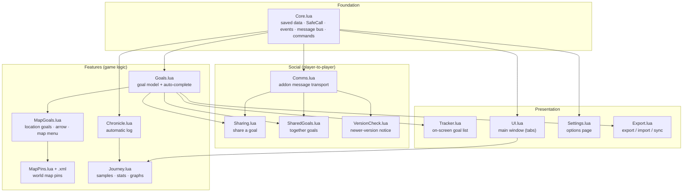

`.toc` order: `Core → Chronicle → Goals → MapGoals → MapPins.lua → MapPins.xml → Tracker → Comms → Sharing → SharedGoals → Export → VersionCheck → Settings → UI → Journey`

Modules rarely call each other directly. They communicate through **Core's three hubs**:

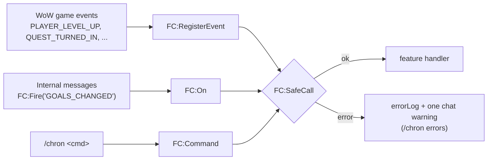

**Error isolation:** every handler runs inside `FC:SafeCall` (an `xpcall`). If one feature breaks, say the map pins on an unexpected client, the error is logged and passed to the game's error handler, and every other feature keeps running. The chronicle must never stop because of something else.

---

## 3. How things happen: event flow

### WoW events → features
| WoW event | Handled in | Result |
|---|---|---|
| `ADDON_LOADED` | Core | load/merge saved data → fire `READY` |
| `ADDON_LOADED` (Blizzard_WorldMap) | MapGoals (`FC:WhenWorldMap`) | hook map clicks, register pin provider |
| `PLAYER_ENTERING_WORLD`, `ZONE_CHANGED_NEW_AREA` | Chronicle | first-visit zone entry → fire `ZONE` |
| `PLAYER_LEVEL_UP` | Chronicle | level entry → fire `LEVEL` |
| `QUEST_TURNED_IN` | Chronicle | quest entry → fire `QUEST(title, id)` |
| `PLAYER_DEAD` | Chronicle | death entry + counter |
| `ACHIEVEMENT_EARNED` | Chronicle | achievement entry |
| `CHAT_MSG_ADDON` | Comms | reassemble chunks → `FC:OnComm` handlers |
| `GROUP_ROSTER_UPDATE` | SharedGoals, VersionCheck | catch-up sync · announce version |
| `FRIENDLIST_UPDATE` | SharedGoals | catch-up sync for friends who came online |

### Internal messages (`FC:Fire` → `FC:On`)
| Message | Fired by | Listened to by |
|---|---|---|
| `READY` | Core | Chronicle, Goals, MapGoals, Tracker, Comms, SharedGoals, Settings, VersionCheck, Journey |
| `ENTRY_ADDED(entry)` | Chronicle, Export | UI, Journey |
| `LEVEL(level)` / `ZONE(zone)` / `QUEST(title, id)` | Chronicle | Goals, SharedGoals, Journey (+ Tracker for LEVEL) |
| `GOAL_ADDED(goal, index)` | Goals | MapGoals (place waypoint), UI (select it) |
| `GOAL_COMPLETED(goal)` / `GOAL_REMOVED(goal)` | Goals | MapGoals (clear waypoint), SharedGoals (leave on remove) |
| `GOALS_CHANGED` | Goals, SharedGoals, Export | UI, Tracker, MapGoals (ticker on/off), MapPins |
| `SHARED_PART_DONE(goal)` | SharedGoals | MapGoals (clear your arrow) |
| `LOCATIONS_UPDATED` | MapGoals (every 1 s while needed) | Tracker, UI (live distance) |
| `SAMPLES_CHANGED` | Journey | Journey (redraw chart) |
| `SETTINGS_CHANGED(var)` | Settings | Tracker |

### Example: one level-up, end to end

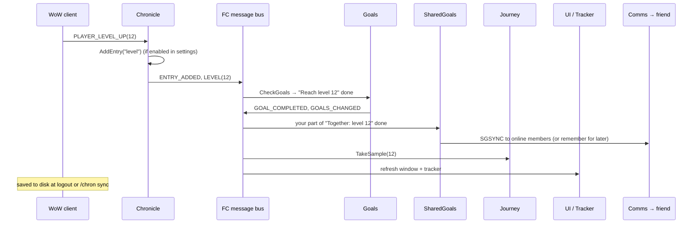

---

## 4. Data model

All data for each character lives in one SavedVariables table, `ForeverChronicallerDB`, declared in the `.toc` (`SavedVariablesPerCharacter`). Defaults are merged into older saves on load, so new fields never break old data.

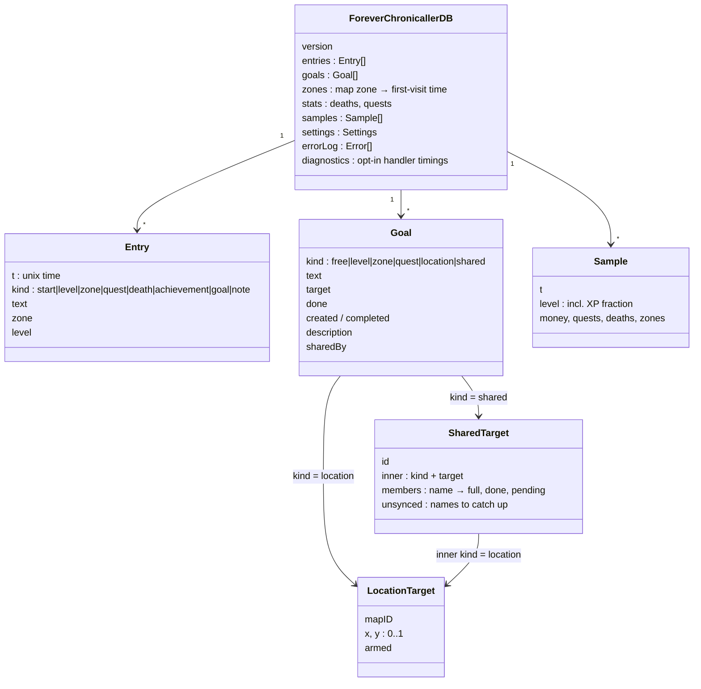

Data that is deliberately *not* saved: live distances (`FC.goalDistance`, a weak table), the outgoing message queue, pending popups, and the import undo backup (kept for the session only).

---

## 5. Goals

### Goal types and what completes them
| `kind` | Created by | Completes when | Checked by |
|---|---|---|---|
| `free` | `/chron goal Buy a mount` | you tick it (`/chron done n`, checkbox) | you |
| `level` | `/chron goal level 30` | `LEVEL` ≥ target (or already reached) | Goals |
| `zone` | `/chron goal zone Duskwood` | `ZONE` matches | Goals |
| `quest` | `/chron goal quest Hogger` / `quest 176` | `QUEST` title or ID matches | Goals |
| `location` | Ctrl + right-click map, `/chron goal here`, `/chron goal 45 63` | within `arrivalYards` after being armed | MapGoals (1 s ticker) |
| `shared` | `/chron together Buddy <any of the above>` | **every joined member** has done their part | SharedGoals (+ MapGoals for locations) |

### Goal lifecycle

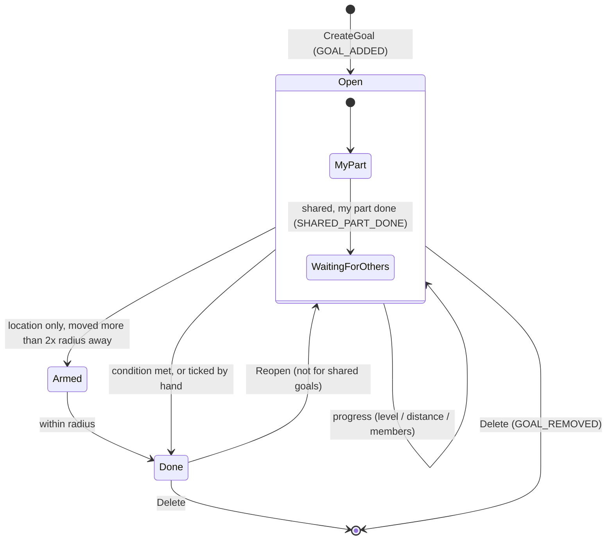

"Armed" exists so that `/chron goal here` doesn't complete the instant you create it.

### Location goals: map → arrow → arrival

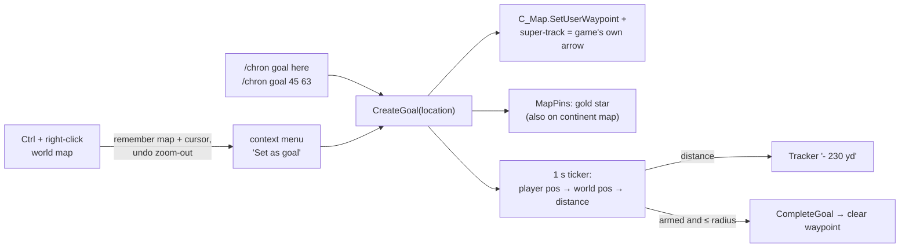

The ticker runs only while open location goals exist. If position APIs are restricted, it stops after one message, and goals can still be ticked by hand.

---

## 6. Player-to-player messaging

### Transport (`Comms.lua`)

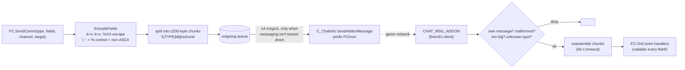

The queue exists because Midnight-style restrictions **block addon messages in instances during encounters, M+ and PvP**. Messages wait instead of being lost.

### Message types
| Type | Channel | Sender → receiver | Meaning |
|---|---|---|---|
| `GOAL` | PARTY/RAID/INSTANCE or WHISPER | Sharing | "here's a goal, want a copy?" → Accept popup |
| `GOALACK` | WHISPER | Sharing | "I accepted your goal" |
| `SGINV` | WHISPER | SharedGoals | invitation to a together goal (full state) → Join popup |
| `SGJOIN` | WHISPER | SharedGoals | "I joined" (sent to all joined members) |
| `SGSYNC` | WHISPER | SharedGoals | full member state, merged on receipt |
| `SGLEAVE` | WHISPER | SharedGoals | "I deleted this goal" |
| `VER` | group / WHISPER reply | VersionCheck | "I run version x.y.z" |

### Together goals: staying in sync with friends who may be offline

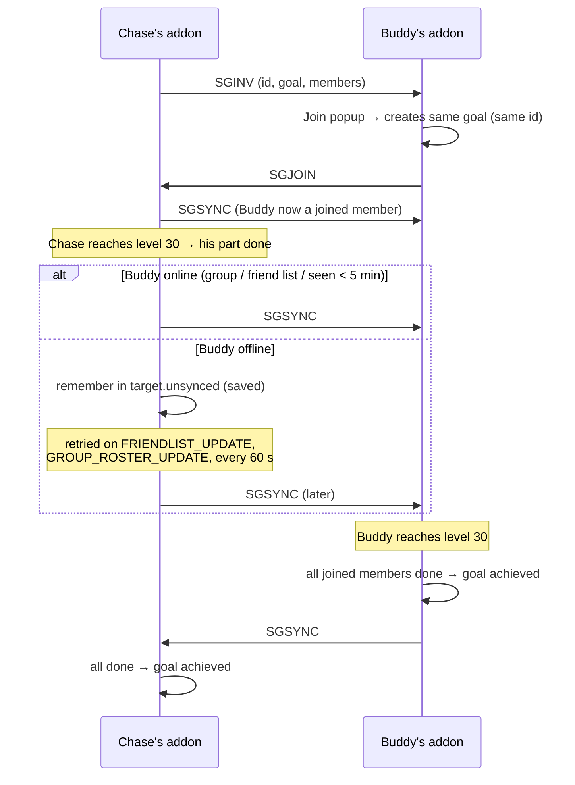

**Merge rules (why it can't loop or go backwards):**
- State only moves forward. A "done" time sticks, the earliest wins, and pending changes to joined, never the reverse.
- Nobody can set *your* part. Only your own client sets it.
- Only existing members can send updates, and membership is capped at 10.
- A client replies only if it **knows more** than the sender (`knowsMore`). After merging, the sender knows everything the replier knew, so the exchange always ends.

---

## 7. Companion app

One Python file, `companion/fcompanion.py`. The release pipeline also builds it into a standalone Windows `.exe` and Linux binary with Python and the addon zip bundled in.

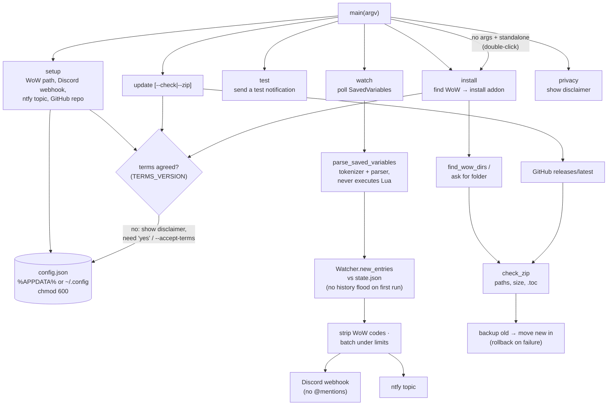

| Safety rule | Where |
|---|---|
| Nothing is installed or changed before the user agrees to the disclaimer (`PRIVACY.md`, once per terms version); `--yes` alone never agrees | `ensure_terms` |
| SavedVariables are parsed, never executed (`X = os.execute(...)` is a parse error) | `parse_saved_variables` |
| Webhook URL never appears in logs or errors | `Watcher.notify` |
| Zip contents must all sit under `ForeverChronicaller/`, with no `..`, absolute paths or drive letters, a size limit, and a `.toc` | `check_zip` |
| Downloads only from `https://github.com/`, release assets only | `latest_release` |
| No install/update while WoW is running (process **names** only) | `game_running` |
| Old version backed up, restored if the swap fails | `install_zip` |

---

## 7a. Telemetry (opt-in)

> **Switched off in this version** by feature flags (`FEATURE_TELEMETRY = False`, `FC.FEATURES.diagnostics = false`): no question, no command, nothing collected. This section documents the built-and-tested design that's planned to be switched on with the Grafana dashboard.

When enabled, telemetry is **off by default**. Nothing below runs unless the player answers *yes* (or passes `--telemetry`). Full disclosure: [PRIVACY.md §3](PRIVACY.md#3-telemetry-not-active-in-this-version).

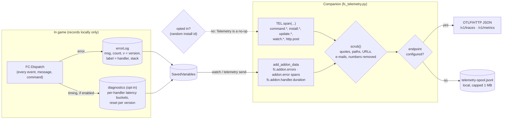

| Signal | Name | Key attributes |
|---|---|---|
| Trace | `command.<name>` and children (`install.verify_zip`, `install.swap`, `update.check`, `update.download`, `watch.process`, `watch.read`, `http.post`) | status, scrubbed exception, `fc.target`, `http.response.status_code` |
| Trace | `addon.error` | `addon.version`, `error.where` (`Goals.lua:42`), `handler`, `error.stack` (locations only) |
| Metric (sum) | `fc.operations` · `fc.errors` · `fc.addon.errors` · `fc.addon.handler.errors` | operation/outcome · error type/location · version |
| Metric (histogram) | `fc.operation.duration` · `fc.addon.handler.duration` | latency in ms, by operation / handler and version |

The endpoint comes from (highest first) the `OTEL_EXPORTER_OTLP_ENDPOINT` / `_HEADERS` environment variables, the companion config, or `telemetry_build.json`, which the release workflow writes from the `OTEL_ENDPOINT` / `OTEL_HEADERS` repository secrets.

---

## 8. Build, test and release pipeline

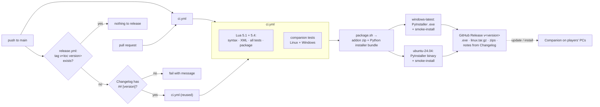

Locally, the same checks are: `lua tests/run.lua .`, `python3 -m unittest discover -s companion/tests` and `scripts/package.sh`.
The addon tests run against **`tests/wow_stub.lua`**, a fake WoW API. It can simulate several players at once (`transfer(a, b)` delivers one player's addon messages to another), so the social features are tested end to end without the game.

---

## 9. Component : function map

### Addon
| File | Responsibility | Key functions / API | Listens to | Emits |
|---|---|---|---|---|
| `ForeverChronicaller.toc` | Manifest: metadata, saved variable, load order | `## Version`, `## Interface`, `SavedVariablesPerCharacter` | – | – |
| `src/core/Core.lua` | Foundation: saved data, error isolation, event dispatch, message bus, slash commands | `FC:SafeCall`, `FC:RegisterEvent`, `FC:On`, `FC:Fire`, `FC:Command`, `FC:Print`, `FC:Zone`; `/chron help`, `/chron errors` | `ADDON_LOADED` | `READY` |
| `src/chronicle/Chronicle.lua` | Automatic adventure log | `FC:AddEntry(kind, text)` (respects settings + cap), `FC:FormatEntry` | `PLAYER_LEVEL_UP`, `ZONE_CHANGED_NEW_AREA`, `PLAYER_ENTERING_WORLD`, `QUEST_TURNED_IN`, `PLAYER_DEAD`, `ACHIEVEMENT_EARNED`, `READY` | `ENTRY_ADDED`, `LEVEL`, `ZONE`, `QUEST` |
| `src/goals/Goals.lua` | Goal model, text parsing, auto-completion | `FC:AddGoal`, `FC:CreateGoal`, `FC:CompleteGoal`, `FC:ToggleGoal`, `FC:RemoveGoal`, `FC:CheckGoals`, `FC:SetGoalDescription`, `FC.ParseGoalText` | `READY`, `LEVEL`, `ZONE`, `QUEST` | `GOAL_ADDED`, `GOAL_COMPLETED`, `GOAL_REMOVED`, `GOALS_CHANGED` |
| `src/goals/MapGoals.lua` | Location goals, waypoint arrow, arrival check, world-map Ctrl + right-click menu | `FC:ParseLocation`, `FC:GoalLocation`, `FC:SetGoalWaypoint`, `FC:WhenWorldMap`, `FC.goalDistance`; `/chron way` | `READY`, `GOAL_ADDED`, `GOAL_COMPLETED`, `GOAL_REMOVED`, `SHARED_PART_DONE`, `GOALS_CHANGED`, `ADDON_LOADED` | `LOCATIONS_UPDATED` |
| `src/goals/MapPins.lua` / `.xml` | Gold-star pins on the world map (projected onto parent maps) | `ForeverChronicallerGoalPinMixin`, map data provider | `GOALS_CHANGED` (+ map's own refresh) | – |
| `src/goals/Tracker.lua` | On-screen open-goal list with progress | `FC:GoalProgressText`, `FC.RefreshTracker`; `/chron tracker` | `READY`, `GOALS_CHANGED`, `LOCATIONS_UPDATED`, `LEVEL`, `SETTINGS_CHANGED` | – |
| `src/core/Comms.lua` | Addon-message transport: encode, chunk, queue, reassemble | `FC:SendComm`, `FC:OnComm`, `FC:GroupChannel`, `FC.EncodeFields`, `FC.DecodeFields`, `FC.ShortName` | `CHAT_MSG_ADDON`, `READY` | comm handlers |
| `src/sharing/Sharing.lua` | Send a goal copy to group/friend, accept popup | `FC:ShareGoal`, `FC.GoalToFields`, `FC.FieldsToGoal` (validation); `/chron share` | comm `GOAL`, `GOALACK` | comm `GOAL`, `GOALACK` |
| `src/sharing/SharedGoals.lua` | Together goals: invites, per-member progress, offline-safe sync | `FC:CreateSharedGoal`, `FC:InviteToShared`, `FC:MarkSharedPartDone`, `FC:SharedProgressText`, `FC.CleanSharedTarget`, `FC:IsMemberOnline`; `/chron together`, `/chron invite` | `READY`, `LEVEL`, `ZONE`, `QUEST`, `GOAL_REMOVED`, `GROUP_ROSTER_UPDATE`, `FRIENDLIST_UPDATE`; comm `SG*` | `SHARED_PART_DONE`, `GOALS_CHANGED`; comm `SG*` |
| `src/sharing/Export.lua` | Export/import strings (backup, other PC), `/chron sync` | `FC:ExportString`, `FC:ImportString(str, "merge"/"replace")`, `FC:UndoImport`; `/chron export`, `/chron import`, `/chron sync` | – | `GOALS_CHANGED`, `ENTRY_ADDED` |
| `src/core/Core.lua` (diagnostics) | Opt-in handler timing (off by default), version-linked error log | `FC:Dispatch(label, fn, ...)`, `FC.DIAG_BOUNDS`; `/chron diagnostics` | – | – |
| `src/core/VersionCheck.lua` | Tell players about newer versions in their group | `FC.version`, `FC.CompareVersions`; `/chron version` | `READY`, `GROUP_ROSTER_UPDATE`; comm `VER` | comm `VER` |
| `src/ui/Settings.lua` | Options page (Settings API) | `FC:OpenSettings`; `/chron config` | `READY` | `SETTINGS_CHANGED` |
| `src/ui/UI.lua` | Main window: Chronicle tab, quest-log-style Goals tab, extra tabs | `FC:Toggle`, `FC.Refresh`, `FC:AddWindowTab`, `FC:DescribeGoalType`; `/chron`, `note`, `goal`, `goals`, `done`, `del`, `recent` | `ENTRY_ADDED`, `GOALS_CHANGED`, `GOAL_ADDED`, `LOCATIONS_UPDATED` | – |
| `src/chronicle/Journey.lua` | Progress samples, statistics, line charts (Journey tab) | `FC:TakeSample`, `FC:JourneyStats`, `FC:JourneySummary`, `FC:ChartPoints`; `/chron journey` | `READY`, `LEVEL`, `QUEST`, `ENTRY_ADDED`, `SAMPLES_CHANGED` | `SAMPLES_CHANGED` |

### Outside the game
| Path | Responsibility |
|---|---|
| `companion/fcompanion.py` | Companion: `setup`, `test`, `watch`, `update`, `install`. SavedVariables parser, Discord/ntfy, zip validation, WoW-folder detection, standalone (double-click) mode |
| `companion/fc_telemetry.py` | Opt-in OpenTelemetry: spans, metrics, scrubbing, addon error/diagnostic import, OTLP export or local spool |
| `companion/Install.bat`, `install.sh` | Launchers for the Python-based installer bundle |
| `companion/tests/` | Companion tests (parser, watcher, update, install, standalone mode, version match) |
| `tests/wow_stub.lua`, `tests/run.lua`, `tests/test_*.lua` | Fake WoW API (multi-player), test runner, addon tests |
| `scripts/package.sh` | Builds `dist/ForeverChronicaller-<v>.zip` (from the `.toc` list) and `ForeverChronicaller-Installer-<v>.zip` |
| `scripts/release_notes.sh` | Prints a version's Changelog section |
| `.github/workflows/ci.yml` | Tests on push to main / PRs (also reused by release) |
| `.github/workflows/release.yml` | Automatic versioned release with standalone installers |
| `README.md` · `Changelog.md` · `docs/TODO.md` · `CLAUDE.md` · `docs/Topology.md` | Usage · history · roadmap · contributor rules · this map |

### Slash command → owner
| Command | File | | Command | File |
|---|---|---|---|---|
| `/chron` | UI | | `/chron share` | Sharing |
| `note`, `goal`, `goals`, `done`, `del`, `recent` | UI | | `together`, `invite` | SharedGoals |
| `way` | MapGoals | | `export`, `import`, `sync` | Export |
| `tracker` | Tracker | | `version` | VersionCheck |
| `journey` | Journey | | `config` / `options` | Settings |
| `help`, `errors`, `privacy`, `diagnostics` | Core | | | |

---

## 10. Design rules and constraints

| Constraint | Consequence in the design |
|---|---|
| No network or file access in addons | Companion app for Discord, push, install, update. SavedVariables is the only way out of the game |
| Saved data written only on logout or `/reload` | Companion polls the file; `/chron sync` reloads on request |
| Midnight-style restrictions: combat log and combat data unavailable, addon messages blocked in instance encounters/M+/PvP | No combat-based features; Comms queues messages; position errors stop polling gracefully |
| Untested-in-game code at release | Error isolation (`FC:SafeCall`), `/chron errors`, stub-API test suite, every API guarded with `if X and X.Y` |
| Other players' data is untrusted | Every incoming message and import is validated (types, lengths, ranges, membership). Nothing is ever executed |
| Friends may be offline | Together-goal state is saved, merged forward-only and synced on contact |
| Players shouldn't need Python | PyInstaller standalone builds per platform in the release pipeline |
| Telemetry must be opt-in and anonymous | Off by default, explicit yes only, random ID deleted on opt-out, every free-text value scrubbed, labels limited to code names, a personal-data leak test |

---

## 11. Where to start reading

1. `ForeverChronicaller.toc`: what loads, in what order.
2. `src/core/Core.lua`: the four building blocks (`SafeCall`, events, message bus, commands). Everything else uses them.
3. `src/chronicle/Chronicle.lua` → `src/goals/Goals.lua`: the core features, and how WoW events become internal messages.
4. `tests/test_core.lua` and `tests/test_goals_settings.lua`: how to drive the addon without the game.
5. Then whichever area you're changing, using the [component map](#9-component--function-map) above.
